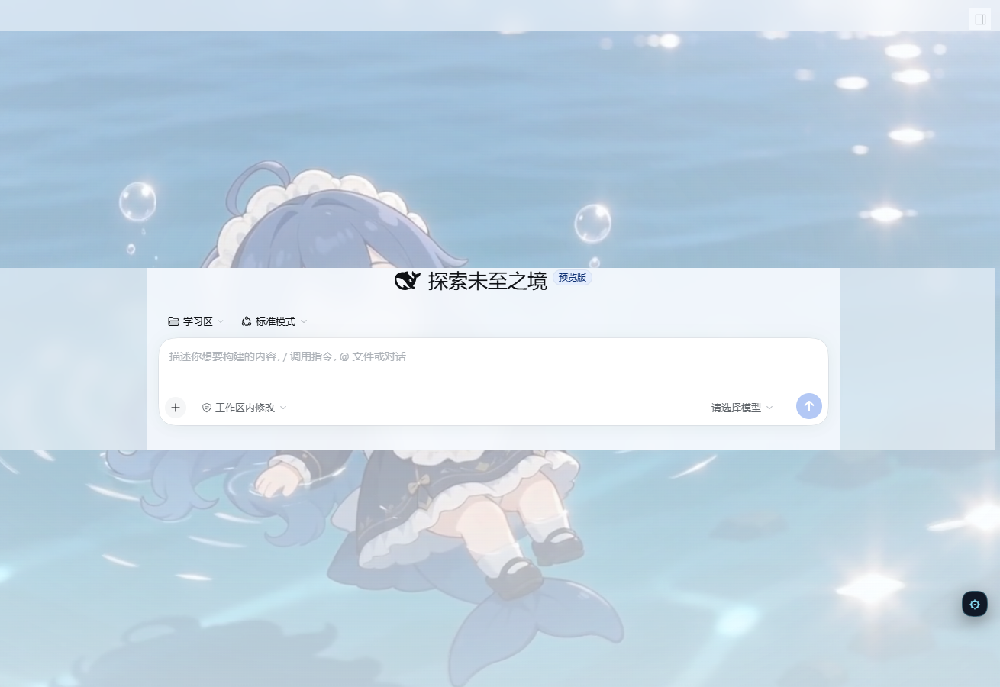
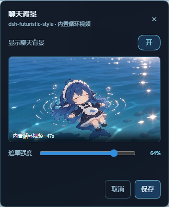

# dsh-futuristic-style

Cinematic cold-start animation with the original soundtrack and a looping anime
chat background for **DeepSeek Harness**.

A 10-second whale-breach cold start, a 1.2-second dissolve into the chat, and a
frosted background-video layer with a small settings gear.






## 中文简介

为 DeepSeek Harness 提供一套完整的视觉启动体验：

- 10 秒冷启动动画，使用原片的 AAC 原声
- 结束或跳过时，用 1.2 秒叠化过渡到聊天界面
- 聊天背景循环播放一段动漫海面视频
- 右下角齿轮可开关背景、调整遮罩强度
- 首屏封面在 React 之前注入，不露出 “Loading plugins” 闪屏

## Features

### Cold start

- 10.03 s, 1280×720, 60 fps, H.264; the original AAC stereo track is muxed
  into the video, no separate synthesized audio.
- A host-injected poster cover paints before React; the boot overlay takes over
  at about 1 s with no loading-screen flash.
- Skip, sound on/off, progress line, and keyboard Escape to skip.
- The sound button mutes or unmutes the video's own audio; if autoplay policy
  blocks sound, it starts muted and the button reads `声音：关`.
- **1.2 s dissolve**: the boot layer fades with a slight push-in while the chat
  UI and background crossfade in from a soft blur/scale.
- Plays once per browser session. `prefers-reduced-motion: reduce` skips it.
- Missing or corrupt media fails open immediately; DSH stays usable.

### Chat background

- One built-in looping background video: 1920×1080, 60 fps, H.264, 18.2 MB.
- First-frame poster for loading and missing-video fallback.
- Standalone gear panel: enable/disable, veil strength, and a preview.
- Settings persist to `~/.dsh/dsh-futuristic-style/config.json`.
- Light and dark DSH themes are supported; the dark theme uses a transparent
  shell with frosted sidebar, header, composer, and menus.
- The composer and the plus menu have their own frosted surfaces; the plus menu
  uses a near-opaque material so chat text cannot bleed through.
- No background picker and no rotation: exactly one video.

## Requirements

- Windows
- DeepSeek Harness Desktop **0.2.1-rc.2**
- No separate media download; the 24.6 MB package includes the videos, audio,
  posters, host routes, and client code

Other DSH versions are not declared compatible. The plugin uses public DSH
bundle/client APIs and the desktop index-injection path.

## Install

### From a GitHub Release

1. Fully quit DSH: close the window, right-click the tray icon and quit, then
   confirm there is no `DeepSeek Harness.exe` process.
2. Run:

```powershell
dsh plugin --profile desktop add "https://github.com/HWQAAA/dsh-futuristic-style/releases/download/v0.1.0/dsh-futuristic-style-0.1.0.tgz"
```

If `dsh` is not on `PATH`, use the CLI shipped with DSH:

```powershell
& "<DSH install dir>\resources\runtime\cli\bin\dsh.cmd" plugin --profile desktop add "https://github.com/HWQAAA/dsh-futuristic-style/releases/download/v0.1.0/dsh-futuristic-style-0.1.0.tgz"
```

3. Reopen DSH.

### From a local tgz

```powershell
dsh plugin --profile desktop add "C:\path\to\dsh-futuristic-style-0.1.0.tgz"
```

### Conflict note

If `dsh-boot-suite` or another startup-animation/wallpaper plugin is installed,
disable it first. Two startup overlays or two background layers will fight.

## Usage

- First page load after restart: poster cover → cold start → 1.2 s dissolve →
  chat with the background video.
- `跳过` or `Escape` ends the cold start early; the same dissolve is used.
- `声音：开/关` controls the original video audio.
- Bottom-right gear: enable/disable the background, adjust the veil, preview
  the video poster, and save.
- The background video is muted by design (the source track is near-silent).

## Compatibility and limits

- Boot video is 720p and is upscaled.
- Autoplay policy can mute boot audio until the sound button is pressed.
- `prefers-reduced-motion: reduce` skips the cold start by design.
- Theme selectors are tuned for DSH 0.2.1-rc.2 hashed class names; a future DSH
  version may need selector updates.
- Windows desktop only. Web, macOS, and Linux are untested.
- The plugin does not download anything at runtime and sends no telemetry.

## Privacy

- All media and code are local. The plugin does not make network requests.
- The only persistent state is the background settings file under
  `~/.dsh/dsh-futuristic-style/` and DSH's own profile.
- The boot animation runs once per browser session; DSH session storage holds
  only a versioned `1` flag.

## Uninstall

Fully quit DSH, then:

```powershell
dsh plugin --profile desktop remove dsh-futuristic-style
```

Reopen DSH. If the app does not start after installation, remove the plugin with
the same command while DSH is closed.

## Development

```powershell
pnpm install --frozen-lockfile
pnpm build
pnpm typecheck
pnpm test
```

Pinned toolchain: Node 24.21.0, pnpm 11.28.5, TypeScript 5.9.3, React 18.3.1,
Vite 8.3.8, Vitest 5.1.0. Tests: 9 passing.

Repository layout:

- `src/host/` — config API, byte-range media routes, index-injected boot cover
- `src/client/` — boot overlay, background layer, gear panel, CSS
- `src/shared/` — config schema and public payload
- `assets/` — cold-start video/audio, background video, posters
- `lib/` — built host/client output
- `docs/screenshots/` — README images

## License and assets

- **Code** (`src/`, `lib/`): MIT, see [LICENSE](LICENSE).
- **Bundled media** (`assets/`): © 2026 HWQAAA, all rights reserved; permitted
  only as part of an unmodified copy of this plugin. See [ASSETS.md](ASSETS.md).

## Issues

Please open an issue at
<https://github.com/HWQAAA/dsh-futuristic-style/issues> and include your DSH
version, Windows version, and whether the problem happens with the boot layer,
the background layer, or the gear panel.
